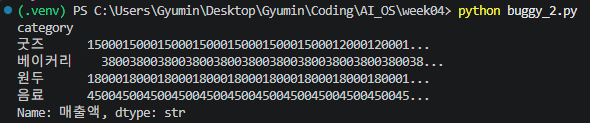
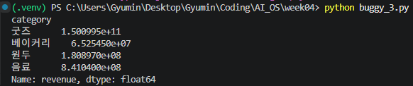
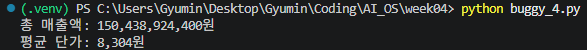

### [buggy_1.py] 진단, 검증 및 AI 활용 기록
#### 1. 진단 보고 및 검증 증빙
* **무엇이:** `ValueError: invalid literal...` 및 빈 문자열(`''`) 변환 에러.
* **어디서:** `buggy_1.py` 19번째 줄 `price = int(row["price"])`.
* **왜:** 단가에 포함된 콤마(`,`), '원' 기호, 결측치(빈 문자열)를 `int()` 함수가 정수로 인식하지 못해 발생함.
* **검증 증빙 및 회귀 확인:**
    * **수정 후 정상 실행:** 에러 없이 "총 매출액: 151,198,388,824원"이 정상 출력됨을 확인.
    * **회귀 확인 (Regression Check):** 문자열 치환 코드(.replace())를 추가한 뒤, 콤마나 단위가 애초에 없는 정상적인 숫자 데이터(예: 4500)가 들어왔을 때 기존 멀쩡했던 기능이 망가지거나 값이 훼손되지 않고 여전히 올바르게 4500으로 변환되는지 확인함.   

#### 2. AI 활용 기록
**[프롬프트: 5요소]**
* **① 맥락:** 매출 누적 스크립트 내 형 변환 에러 해결.
* **② 코드:** `price = int(row["price"])`
* **③ Traceback:** `ValueError: invalid literal... '5,200'` 및 `''`.
* **④ 내가 확인한 것:** Traceback 에러 위치의 실제 데이터가 콤마를 포함한 문자열임을 확인함.
* **⑤ 요청:** 문자열 전처리와 결측치 예외 처리 코드 제안 요청. 아울러 `.strip()`을 뺐는데도 정상 작동한 이유에 대한 설명 요구.
**[답변 요지 및 검증]**
* **AI 답변 요지:** `.replace()` 체이닝으로 불필요한 문자를 지우고, `if`문으로 빈 문자열을 0으로 처리하도록 제안함. `.strip()`이 없어도 되는 이유는 파이썬 `int()` 함수가 앞뒤 공백을 자동으로 무시하기 때문이라고 설명함.
* **채택/기각 및 검증 의견:** **채택**. 제안된 로직을 적용(불필요한 `.strip()` 제외)하여 스크립트 정상 작동 및 정확한 매출액(151,198,388,824원) 출력을 확인함. `int()` 함수의 공백 무시 특성에 대한 AI의 설명 덕분에 코드의 원리를 정확히 납득하고 교차 검증함.

---

### [buggy_2.py] 진단, 검증 및 AI 활용 기록
#### 1. 진단 보고 및 검증 증빙
* **무엇이:** `KeyError: '단가'` 발생.
* **어디서:** `buggy_2.py` 20번째 줄 `df["매출액"] = df["단가"] * df["수량"]` 구문.
* **왜:** 원본 CSV 데이터를 판다스로 읽어왔으나, 실제 존재하는 컬럼명은 영문(`price`, `quantity`)인데 코드에서는 존재하지 않는 한글명(`단가`, `수량`)으로 인덱싱을 시도하여 키를 찾지 못함.
* **검증 증빙 및 회귀 확인:**
    * **수정 후 정상 실행:** 스크립트 중단(KeyError) 없이 `groupby` 집계 결과가 끝까지 출력됨을 확인. (문자열 반복 결합이 일어나는 현상은 있으나 에러는 해결됨).
    * **회귀 확인:** 올바른 영문 컬럼명을 지정함으로써, 데이터프레임의 벡터화 연산 기능이 망가지지 않고 에러 없이 호출됨을 확인.

#### 2. AI 활용 기록
* **[buggy_2.py] AI 활용 기록: AI 미사용**

---

### [buggy_3.py] 진단, 검증 및 AI 활용 기록
### 1. 진단 보고 및 검증 증빙
* **무엇이:** `AttributeError: 'NoneType' object has no attribute 'groupby'` 에러 발생.
* **어디서:** `buggy_3.py` 28번째 줄 `result = df.groupby("category")["revenue"].sum()` 구문.
* **왜:** 앞 단계의 `load_and_clean()` 함수가 정제된 `df`를 반환(return)하지 않아 암묵적으로 `None`을 넘겼고, 메인 함수의 `df` 변수가 `None` 타입으로 변질되어 `groupby` 호출 시 속성 에러가 발생함.
* **검증 증빙 및 회귀 확인:**
    * **수정 후 정상 실행:** `return df` 추가 후 에러 없이 카테고리별 매출액 집계 결과가 올바르게 출력됨을 확인.
    * **회귀 확인:** `return` 문을 추가함으로써 앞서 수행한 가격 정제(`,` 및 `원` 제거, 숫자 변환)와 매출액 연산 결과가 조금도 훼손되지 않고 메인 함수로 온전히 전달됨을 확인.

#### 2. AI 활용 기록
**[프롬프트: 5요소]**
* **① 맥락:** 데이터를 읽고 정제한 뒤, 메인 함수에서 `groupby`로 카테고리별 매출 합계를 구하려는 스크립트.
* **② 코드:** `result = df.groupby("category")["revenue"].sum()`
* **③ Traceback:** `AttributeError: 'NoneType' object has no attribute 'groupby'`
* **④ 내가 확인한 것:** 에러 로그를 통해 집계를 수행하려는 변수 `df`가 데이터프레임이 아닌 `None` 상태임을 확인함.
* **⑤ 요청:** 해결 코드를 제시해 주고, 명시적인 에러 처리가 없었음에도 왜 이런 방식으로 에러가 전파되는지 파이썬의 특성에 기반하여 수정한 코드의 설명을 요구함.

**[답변 요지 및 검증]**
* **AI 답변 요지:** 함수 마지막 줄에 `return df`를 추가해야 함을 제시함. 파이썬의 함수는 `return`을 명시하지 않으면 암묵적으로 `None`을 반환하며, 이 `None`이 호출부 변수(`df`)에 저장되어 결국 `None.groupby()`가 실행되기 때문에 속성 에러가 발생한다고 코드의 동작 과정을 설명함.
* **채택/기각 판단 및 본인 검증 의견:** **채택**. `return df`를 추가한 후 정상적인 집계 결과가 출력됨 확인. "함수가 아무것도 반환하지 않으면 `None`을 반환한다"는 AI의 설명이 Traceback의 `'NoneType'`의 원인을 짚어주었으므로, 올바른 진단 및 설명임을 확인 및 교차 검증함.

---

### [buggy_4.py] 진단, 검증 및 AI 활용 기록
#### 1. 진단 보고 및 검증 증빙
* **무엇이:** 스크립트가 에러 없이 끝까지 실행되지만, 산출된 총 매출액이 약 1,511억 원으로 비상식적으로 높게 나오는 논리적 오류 발생.
* **어디서:** `price` 데이터를 숫자로 변환한 뒤 집계하는 25~31번째 줄 구간.
* **왜:** `df.info()`와 `df.describe()`로 데이터를 뜯어보니 결측치(NaN) 2건뿐만 아니라, 음수 가격(-4,500원)과 플레이스홀더 성격의 극단적 이상치(9,999,999원)가 그대로 더해져 전체 합계를 심각하게 왜곡하고 있었음.
* **처리 방법 및 코드 적용:**
비중이 낮은 결측치는 안전하게 삭제(`dropna`)하고, 음수 및 극단값은 도메인 상식 기준에 맞게 필터링함.
```python
# FIXED: 결측치(NaN)가 포함된 행 제거
df = df.dropna(subset=["price"])

# FIXED: 입력 오류(음수) 및 극단적 이상치(플레이스홀더)를 도메인 기준으로 필터링
df = df[(df["price"] > 0) & (df["price"] < 1000000)]
```
* **검증 증빙 및 회귀 확인:**
    * **수정 후 정상 실행:** 결측치, 음수, 극단값이 정제되어 합리적인 총 매출액(150,438,924,400원)과 평균 단가(8,304원)가 정상 산출됨을 확인.
    * **회귀 확인:** 정제 필터 조건을 적용할 때 아메리카노(4,500원) 등 기존 정상 가격 데이터가 누락되지 않고 온전히 집계에 반영됨을 확인함.

#### 2. AI 활용 기록
* **AI 활용 여부:** **미사용**